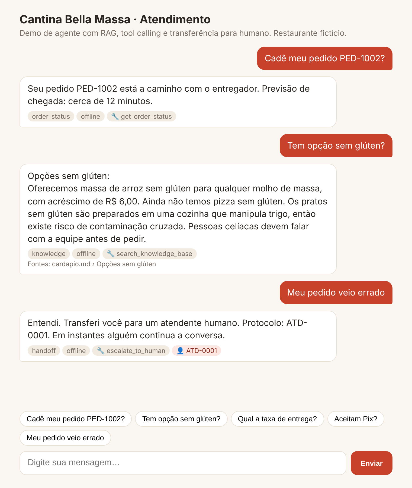
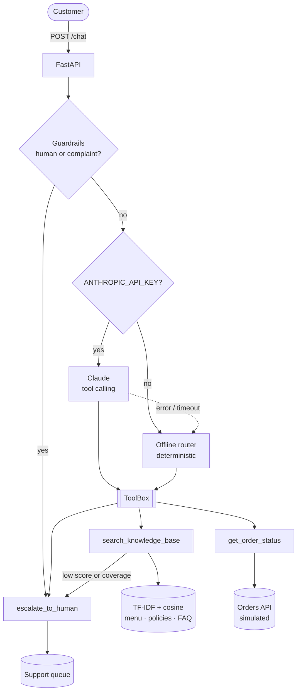
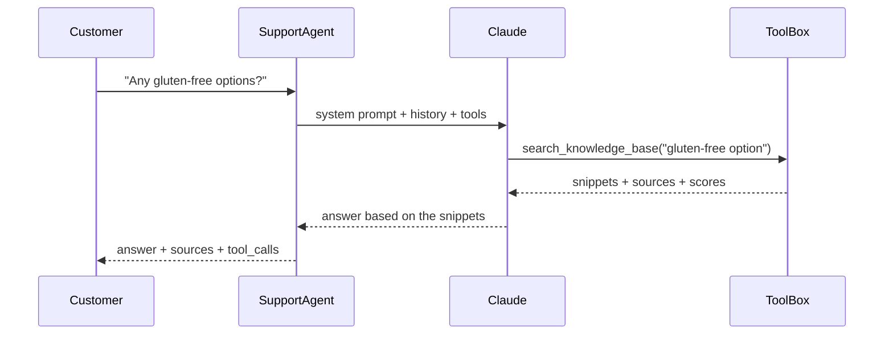

🌐 **English** | [Português (BR)](README.pt-BR.md)

# 🍝 Restaurant Support Agent

[](https://github.com/PresetyX/restaurant-support-agent/actions/workflows/ci.yml)


Customer support agent for delivery restaurants. It answers questions about the menu and
policies with **RAG**, checks order status with **tool calling**, and
**hands the conversation off to a human agent** when it doesn't know the answer or when the
customer complains.

> Portfolio project. The restaurant (Cantina Bella Massa), the menu and the orders are
> fictional, and the orders API is simulated. The scenario is a Brazilian delivery restaurant,
> so the demo UI and the agent's replies are in Brazilian Portuguese.



<!-- Replace with the GIF once recorded:  -->
**Live demo:** [restaurant-support-agent.vercel.app](https://restaurant-support-agent.vercel.app) (offline mode, no API key; the data is fictional and conversation history is not persisted between runs)

---

## The problem

A large share of the messages a restaurant receives are repetitive: "where is my order?",
"do you have gluten-free options?", "what's the delivery fee?". Answering them by hand ties up
the team at peak hours. These questions can be automated safely, **as long as** the agent:

1. answers only from the restaurant's official information (without inventing prices or lead times);
2. looks up real order data instead of guessing;
3. knows when to pass the conversation to a person.

This project implements those three guarantees and covers them with automated tests.

## Features

| Feature | How it works |
|---|---|
| **RAG over menu and policies** | Markdown documents split by section, indexed with TF-IDF and searched by cosine similarity. Every answer cites its source (`cardapio.md › Opções sem glúten`). |
| **Tool calling** | `get_order_status`, `search_knowledge_base` and `escalate_to_human` exposed to Claude with JSON Schema. The model decides which one to call. |
| **Human handoff** | Triggered by an explicit request, a complaint, or when the knowledge base has no answer. Generates a ticket number (`ATD-0001`) in the support queue. |
| **Deterministic guardrails** | A request for a human and a complaint **always** escalate, without depending on the LLM. Questions about allergies get a safety notice. |
| **Graceful fallback** | Without an API key, or if the LLM fails (timeout, error, tool loop), the agent answers in offline mode with the same set of tools. |
| **Automated evaluation** | A golden set of 17 cases runs in CI, with a minimum accuracy target. |
| **API + demo UI** | FastAPI with `/chat`, `/health` and `/handoffs`, plus a chat page at `/`. |

## Architecture



Flow of a menu question in LLM mode:



### Technical decisions

- **Why TF-IDF and not dense embeddings?** It runs without a GPU, without a key and
  deterministically, which makes it possible to test the RAG in CI. The search sits behind the
  `Retriever` interface, so swapping in pgvector, Chroma or an embeddings model doesn't change
  the agent.
- **Two relevance criteria.** Similarity alone let one-word false positives through: the
  evaluation caught "weather in Paris" matching "Delivery *time*" (in Portuguese, "previsão do
  *tempo* em Paris" vs. "Tempo de entrega"). So a snippet must also cover a minimum share of
  the query terms (`MIN_QUERY_COVERAGE`). The case became a regression test.
- **Guardrails outside the LLM.** Escalating to a human is a business decision and can't depend
  on the model "remembering" the rule. It is applied before the LLM call.
- **Tools never raise exceptions.** Errors (unknown order, missing argument, unknown tool) come
  back as a structured result for the agent to handle.

## Quick start

### With Docker

```bash
docker build -t restaurant-support-agent .
docker run -p 8000:8000 restaurant-support-agent
# LLM mode:
docker run -p 8000:8000 -e ANTHROPIC_API_KEY=your_key restaurant-support-agent
```

Open http://localhost:8000 for the demo UI or http://localhost:8000/docs for Swagger.

### With Python

```bash
git clone https://github.com/PresetyX/restaurant-support-agent.git
cd restaurant-support-agent
python -m venv .venv && source .venv/bin/activate   # Windows: .venv\Scripts\activate
pip install -e ".[dev]"
cp .env.example .env                                  # optional: set your ANTHROPIC_API_KEY
uvicorn app.main:app --reload
```

### Example request

The agent speaks Brazilian Portuguese. Here the customer asks "Where is my order PED-1002?":

```bash
curl -X POST http://localhost:8000/chat \
  -H "Content-Type: application/json" \
  -d '{"message": "Cadê meu pedido PED-1002?"}'
```

```json
{
  "answer": "Seu pedido PED-1002 está a caminho com o entregador. Previsão de chegada: cerca de 12 minutos.",
  "intent": "order_status",
  "mode": "offline",
  "sources": [],
  "tool_calls": [{ "name": "get_order_status", "arguments": { "order_id": "PED-1002" }, "result": { "found": true, "status": "saiu_para_entrega", "eta_minutes": 12 } }],
  "handed_off": false,
  "ticket_id": null
}
```

(The answer reads: "Your order PED-1002 is on its way with the courier. Estimated arrival: about 12 minutes.")

## Use cases

| Customer message | What the agent does |
|---|---|
| "Cadê meu pedido PED-1002?" (Where is my order PED-1002?) | Calls `get_order_status` and reports the status and ETA. |
| "Onde está meu pedido?" (Where is my order?) | Asks for the order number in the `PED-1234` format. |
| "Tem opção sem glúten?" (Any gluten-free options?) | Searches the menu, answers and cites the source. |
| "Sou celíaco, posso pedir?" (I'm celiac, can I order?) | Answers and adds a cross-contamination warning. |
| "Posso cancelar meu pedido?" (Can I cancel my order?) | Understands it is a policy question, not a status question, and looks up the cancellation rule. |
| "Meu pedido veio errado" (My order arrived wrong) | Escalates to a human with the reason `reclamacao` (complaint) and returns the ticket number. |
| "Qual a capital da França?" (What is the capital of France?) | Doesn't find it in the knowledge base and hands off to a human instead of making something up. |

Test orders: `PED-1001` (preparing), `PED-1002` (on the way), `PED-1003` (delivered),
`PED-1004` (cancelled), `PED-1005` (received).

## Tests and evaluation

```bash
pytest --cov=app          # 56 tests, ~96% coverage
python -m evals.run_evals # golden set: 17/17 in offline mode
python -m evals.run_evals --llm   # same golden set using Claude
```

- **Unit tests:** RAG retrieval per question, order ID normalization, tool execution and
  errors, guardrails, fallback when the LLM fails, per-session history and API contracts.
- **Tool calling loop:** tested with a mocked Anthropic client (no network), validating how
  `tool_result` is sent back and the iteration limit.
- **CI (GitHub Actions):** `ruff` lint, tests on Python 3.11 and 3.12 with a minimum coverage
  of 85%, evaluation with a 90% target, and a Docker image build with a smoke test.

## Structure

```
app/
  agent/       # SupportAgent, tool calling loop (Claude), guardrails and prompt
  rag/         # Markdown chunking, PT-BR tokenization, TF-IDF retriever
  tools/       # get_order_status, escalate_to_human, ToolBox and JSON Schemas
  main.py      # FastAPI API
  static/      # demo UI
data/
  knowledge/   # menu, policies and FAQ (RAG knowledge base)
  orders.json  # simulated orders
evals/         # golden set + evaluation script
tests/         # pytest
```

## Configuration

| Variable | Default | Description |
|---|---|---|
| `ANTHROPIC_API_KEY` | empty | Enables LLM mode. Without it, the agent runs offline. |
| `LLM_MODEL` | `claude-sonnet-5-5` | Model used in LLM mode. |
| `RETRIEVAL_TOP_K` | `3` | Snippets returned by the search. |
| `MIN_RETRIEVAL_SCORE` | `0.12` | Minimum similarity to accept a snippet. |
| `MIN_QUERY_COVERAGE` | `0.3` | Minimum fraction of the query terms present in the snippet. |
| `MAX_TOOL_ITERATIONS` | `4` | Tool calling rounds allowed per message. |
| `HISTORY_LIMIT` | `10` | Messages of history kept per session. |

## Limitations and next steps

- History and the support queue live in memory. In production they would go to Redis or a database.
- The search is lexical (TF-IDF with synonyms). Questions whose vocabulary differs a lot from
  the knowledge base may not be found; the next step is to test dense embeddings against the
  same golden set and compare the results.
- The orders API is a local JSON file. The real integration would be an HTTP client with timeout and retry.
- No authentication or rate limiting on the API: this is a demo, not an exposed service.

## Development history

Developed locally between November 4 and November 14, 2026. The commit history was created afterwards, and the commit dates were adjusted to match the period in which the work was actually done.

## License

MIT. See [LICENSE](LICENSE).
