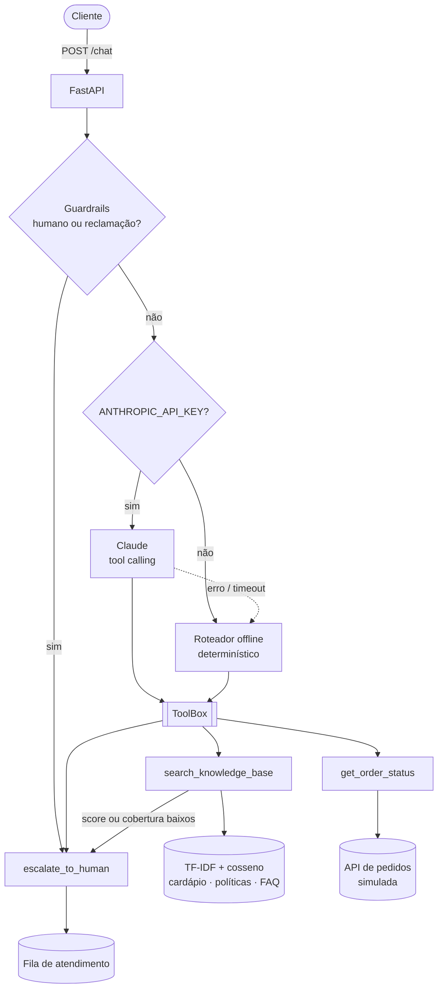
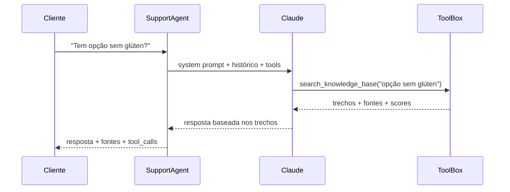

# 🍝 Restaurant Support Agent

[](https://github.com/PresetyX/restaurant-support-agent/actions/workflows/ci.yml)


Agente de atendimento ao cliente para restaurantes de delivery. Ele responde dúvidas sobre
cardápio e políticas com **RAG**, consulta o status de pedidos com **tool calling** e
**transfere para um atendente humano** quando não sabe responder ou quando o cliente reclama.

> Projeto de portfólio. O restaurante (Cantina Bella Massa), o cardápio e os pedidos são
> fictícios, e a API de pedidos é simulada.


<!-- Troque pelo GIF quando gravar:  -->
<!-- Demo online: [link do deploy](https://SEU-DEPLOY-AQUI) -->

---

## O problema

Boa parte das mensagens que chegam a um restaurante é repetitiva: "cadê meu pedido?",
"tem opção sem glúten?", "qual a taxa de entrega?". Responder isso manualmente ocupa a
equipe no horário de pico. Esse tipo de pergunta pode ser automatizado com segurança,
**desde que** o agente:

1. responda só com base em informação oficial do restaurante (sem inventar preço ou prazo);
2. consulte dados reais do pedido em vez de chutar;
3. saiba a hora de passar a conversa para uma pessoa.

Este projeto implementa essas três garantias e as cobre com testes automatizados.

## Funcionalidades

| Recurso | Como funciona |
|---|---|
| **RAG sobre cardápio e políticas** | Documentos Markdown divididos por seção, indexados com TF-IDF e buscados por similaridade de cosseno. Toda resposta cita a fonte (`cardapio.md › Opções sem glúten`). |
| **Tool calling** | `get_order_status`, `search_knowledge_base` e `escalate_to_human` expostas ao Claude com JSON Schema. O modelo decide qual chamar. |
| **Handoff para humano** | Acionado por pedido explícito, por reclamação ou quando a base não tem resposta. Gera um protocolo (`ATD-0001`) na fila de atendimento. |
| **Guardrails determinísticos** | Pedido de humano e reclamação **sempre** escalam, sem depender do LLM. Perguntas sobre alergia recebem aviso de segurança. |
| **Fallback gracioso** | Sem API key, ou se o LLM falhar (timeout, erro, loop de ferramentas), o agente responde em modo offline com o mesmo conjunto de ferramentas. |
| **Avaliação automatizada** | Golden set com 17 casos rodando no CI, com meta mínima de acerto. |
| **API + UI de demo** | FastAPI com `/chat`, `/health` e `/handoffs`, mais uma página de chat em `/`. |

## Arquitetura



Fluxo de uma pergunta sobre cardápio no modo LLM:



### Decisões técnicas

- **Por que TF-IDF e não embeddings densos?** Roda sem GPU, sem chave e de forma
  determinística, o que permite testar o RAG no CI. A busca fica atrás da interface
  `Retriever`, então trocar por pgvector, Chroma ou um modelo de embeddings não muda o agente.
- **Dois critérios de relevância.** Similaridade sozinha deixava passar falsos positivos de
  uma palavra só: a avaliação pegou "previsão do *tempo* em Paris" casando com "Tempo de
  entrega". Por isso o trecho também precisa cobrir parte mínima dos termos da pergunta
  (`MIN_QUERY_COVERAGE`). O caso virou teste de regressão.
- **Guardrails fora do LLM.** Escalar para humano é uma decisão de negócio e não pode
  depender de o modelo "lembrar" a regra. Ela é aplicada antes da chamada ao LLM.
- **Ferramentas nunca levantam exceção.** Erros (pedido inexistente, argumento faltando,
  ferramenta desconhecida) voltam como resultado estruturado para o agente tratar.

## Execução rápida

### Com Docker

```bash
docker build -t restaurant-support-agent .
docker run -p 8000:8000 restaurant-support-agent
# modo LLM:
docker run -p 8000:8000 -e ANTHROPIC_API_KEY=sua_chave restaurant-support-agent
```

Abra http://localhost:8000 para a UI de demo ou http://localhost:8000/docs para o Swagger.

### Com Python

```bash
git clone https://github.com/PresetyX/restaurant-support-agent.git
cd restaurant-support-agent
python -m venv .venv && source .venv/bin/activate   # Windows: .venv\Scripts\activate
pip install -e ".[dev]"
cp .env.example .env                                  # opcional: coloque sua ANTHROPIC_API_KEY
uvicorn app.main:app --reload
```

### Exemplo de chamada

```bash
curl -X POST http://localhost:8000/chat \
  -H "Content-Type: application/json" \
  -d '{"message": "Cadê meu pedido PED-1002?"}'
```

```json
{
  "answer": "Seu pedido PED-1002 está a caminho com o entregador. Previsão de chegada: cerca de 12 minutos.",
  "intent": "order_status",
  "mode": "offline",
  "sources": [],
  "tool_calls": [{ "name": "get_order_status", "arguments": { "order_id": "PED-1002" }, "result": { "found": true, "status": "saiu_para_entrega", "eta_minutes": 12 } }],
  "handed_off": false,
  "ticket_id": null
}
```

## Casos de uso

| Mensagem do cliente | O que o agente faz |
|---|---|
| "Cadê meu pedido PED-1002?" | Chama `get_order_status` e informa status e previsão. |
| "Onde está meu pedido?" | Pede o número no formato `PED-1234`. |
| "Tem opção sem glúten?" | Busca no cardápio, responde e cita a fonte. |
| "Sou celíaco, posso pedir?" | Responde e acrescenta aviso de contaminação cruzada. |
| "Posso cancelar meu pedido?" | Entende que é dúvida de política, não de status, e busca a regra de cancelamento. |
| "Meu pedido veio errado" | Escala para humano com motivo `reclamacao` e devolve o protocolo. |
| "Qual a capital da França?" | Não encontra na base e transfere para humano em vez de inventar. |

Pedidos de teste: `PED-1001` (em preparo), `PED-1002` (a caminho), `PED-1003` (entregue),
`PED-1004` (cancelado), `PED-1005` (recebido).

## Testes e avaliação

```bash
pytest --cov=app          # 56 testes, ~96% de cobertura
python -m evals.run_evals # golden set: 17/17 no modo offline
python -m evals.run_evals --llm   # mesmo golden set usando o Claude
```

- **Testes unitários:** recuperação do RAG por pergunta, normalização de ID de pedido,
  execução e erros das ferramentas, guardrails, fallback quando o LLM falha, histórico por
  sessão e contratos da API.
- **Loop de tool calling:** testado com um client da Anthropic simulado (sem rede),
  validando o envio de `tool_result` e o limite de iterações.
- **CI (GitHub Actions):** lint com `ruff`, testes em Python 3.11 e 3.12 com cobertura
  mínima de 85%, avaliação com meta de 90% e build da imagem Docker com smoke test.

## Estrutura

```
app/
  agent/       # SupportAgent, loop de tool calling (Claude), guardrails e prompt
  rag/         # chunking de Markdown, tokenização PT-BR, retriever TF-IDF
  tools/       # get_order_status, escalate_to_human, ToolBox e JSON Schemas
  main.py      # API FastAPI
  static/      # UI de demo
data/
  knowledge/   # cardápio, políticas e FAQ (base do RAG)
  orders.json  # pedidos simulados
evals/         # golden set + script de avaliação
tests/         # pytest
```

## Configuração

| Variável | Padrão | Descrição |
|---|---|---|
| `ANTHROPIC_API_KEY` | vazio | Ativa o modo LLM. Sem ela, o agente roda offline. |
| `LLM_MODEL` | `claude-sonnet-5-5` | Modelo usado no modo LLM. |
| `RETRIEVAL_TOP_K` | `3` | Trechos retornados pela busca. |
| `MIN_RETRIEVAL_SCORE` | `0.12` | Similaridade mínima para aceitar um trecho. |
| `MIN_QUERY_COVERAGE` | `0.3` | Fração mínima dos termos da pergunta presentes no trecho. |
| `MAX_TOOL_ITERATIONS` | `4` | Limite de rodadas de tool calling por mensagem. |
| `HISTORY_LIMIT` | `10` | Mensagens de histórico mantidas por sessão. |

## Limitações e próximos passos

- Histórico e fila de atendimento ficam em memória. Em produção, iriam para Redis ou banco.
- A busca é lexical (TF-IDF com sinônimos). Perguntas com vocabulário muito diferente da
  base podem não ser encontradas; o próximo passo é testar embeddings densos com o mesmo
  golden set e comparar os resultados.
- A API de pedidos é um JSON local. A integração real seria um client HTTP com timeout e retry.
- Sem autenticação nem rate limiting na API: é uma demo, não um serviço exposto.

## Histórico de desenvolvimento

Projeto desenvolvido localmente entre 04/11/2026 e 14/11/2026. O histórico de commits foi criado depois, e as datas dos commits foram ajustadas para corresponder ao período em que o trabalho foi realmente feito.

## Licença

MIT. Veja [LICENSE](LICENSE).
